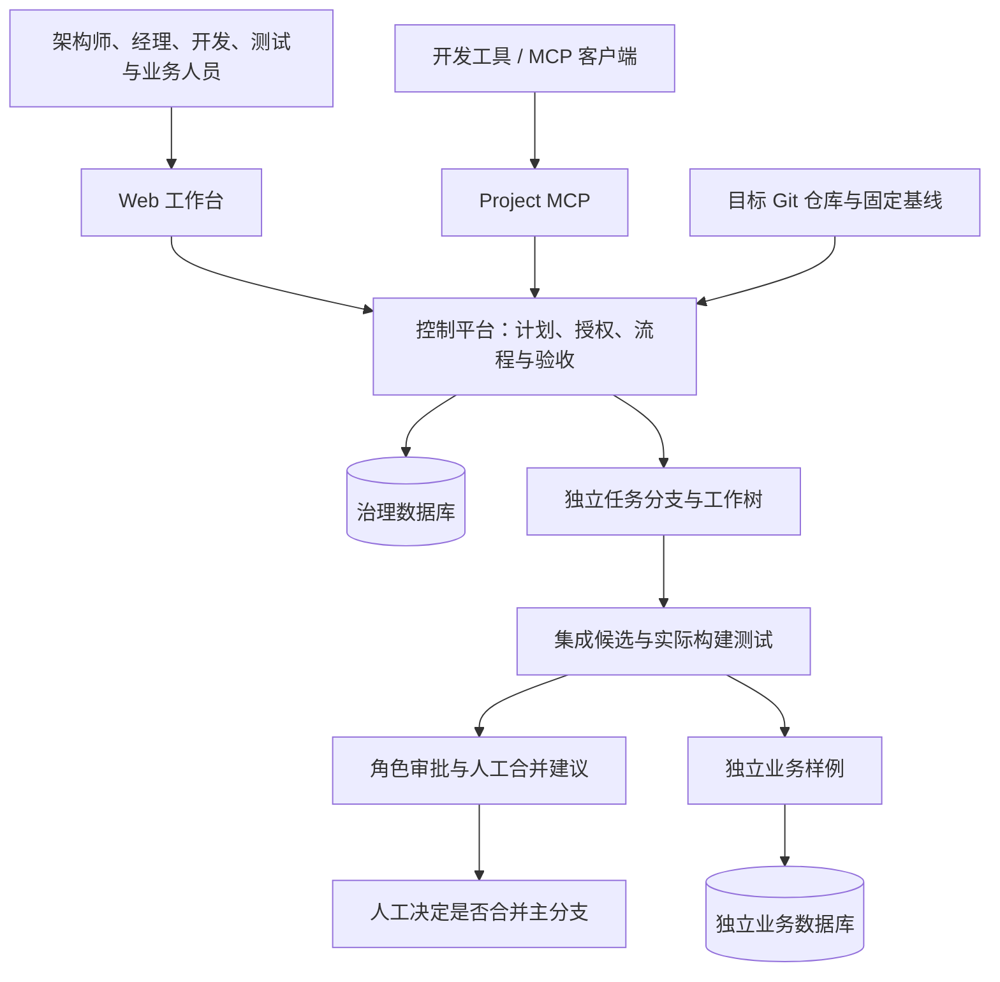

# Refactor Control Plane：项目介绍与阶段成果

**赞助者沟通版｜2026 年 10 月 11 日｜第七里程碑完成后**

本文介绍当前工作区已经实现的能力、可展示的成果及后续投入方向。依据已批准规格、实现代码和阶段验收记录整理；不将规划功能计入现有能力。当前是可运行的单项目、单节点参考实现，完整 v0.1 MVP 尚未完成。

## 1. 一分钟认识这个项目

**Refactor Control Plane 是面向遗留系统升级的重构治理与协作平台。** 它把项目分析、方案确认、任务分配、隔离修改、组合验证和人工验收组织到同一套流程中，帮助团队回答四个问题：

1. 我们依据什么决定这样改？
2. 谁可以修改哪些内容，必须遵守什么前置条件？
3. 多个任务的代码放到一起后，是否真的能够工作？
4. 谁确认了结果，出现中断后如何继续？

项目的核心价值，是让人和未来接入的 AI 执行者在明确的授权、版本与验收规则下协作。现阶段已经建立项目计划与执行治理基础，能够在真实 Git 仓库中完成任务隔离、受控提交、候选组合、实际构建验证和审批后的计划接续。

**面向赞助者的阶段判断：项目已有可以运行、演示和核验的工程成果，下一阶段将把现有治理机制接到实际多执行者调度中。**

## 2. 要解决的实际问题

遗留系统重构往往同时涉及代码理解、依赖升级、接口变化、数据库兼容和业务行为保留。即使每一处修改都不大，多人或多个工具同时参与时，也会出现协作风险。

| 重构中的问题 | 本项目已经提供的处理机制 | 对团队的意义 |
|---|---|---|
| 文档与代码版本不一致，讨论缺少共同依据 | 分析固定 Git 提交，结论关联源文件和对象身份 | 可以复核“当时看的是哪份代码” |
| 方案写在文档里，执行时却使用另一套路径或命令 | 计划绑定仓库、基线、任务、工作目录、权限和验收命令 | 方案能够约束实际执行 |
| 多个参与者修改相同区域，互相覆盖 | 每次执行独立分支和工作树，配合路径租约 | 分离修改现场，并协调写入意图 |
| 上游接口已改变，下游仍使用旧理解 | 契约/Schema 版本变化使相关任务失效，要求重验证 | 显式标出需要重新检查的工作 |
| 单个任务通过，组合后无法编译或行为错误 | 创建真实集成候选，在组合代码上执行配置的检查 | 验证最终组合，而非只看个人任务结果 |
| 已审批方案被静默修改，旧测试被用于新代码 | 不可变计划修订、重新审批、候选与验证指纹绑定 | 降低错误复用历史批准和测试结果的风险 |
| 请求超时或服务中断后，不知道操作是否已经发生 | 幂等操作、持久日志、状态对账与恢复机制 | 先确认实际状态，再决定是否重试 |

这些机制提供的是可执行的控制条件。其实际节省的工时、返工量和交付周期，需要在后续真实项目中测量，目前不承诺具体提升百分比。

## 3. 当前能够做到的功能

以下“已实现”表示相应功能存在且有阶段验证；不代表所有企业环境、语言或异常情况都已经覆盖。

### 3.1 导入并分析目标仓库

平台可以接入本地 Git 仓库，将分析固定到一个明确提交，从 Git 对象读取内容。未提交修改和分析过程中发生的工作区变化不会混入该次分析。

当前能够识别 Maven/npm 依赖声明、源码类型，以及一定范围的模块、配置、数据库协议、SQL 表及引用、Java import、控制器路由片段和视图关系。结果明确区分：

- **事实**：代码或配置中直接可观察的声明。
- **推断**：依据文本和结构推测出的关系，需要进一步确认。
- **未知**：证据不足、格式不支持或超出分析范围。

每条相关证据绑定提交、文件路径与 Git 对象，便于复核。当前关系识别主要由确定性扫描规则实现；不将其描述为已经理解全部业务语义的 AI 分析器，也不宣称具备全语言完整调用图。

### 3.2 建立真正可执行的重构计划

项目级 JSON 计划可以定义目标仓库、固定基线、目标分支、目标架构、架构决策记录（ADR）、任务依赖、角色、资源、授权路径、工作目录和验收命令。

系统会校验依赖是否成环、资源或角色是否存在、路径是否越界、工作目录是否真实存在于基线、任务与验证方案是否一致。已用两个不同目录布局的隔离仓库验证同一治理实现，通用运行时已具备脱离固定文章样例配置的能力。

浏览器支持查看计划、复制和编辑 JSON、导入修订、查看证据、选择版本与审批。首个计划通过启动配置接入，当前并非完整的可视化项目创建向导；通用计划也不是由 AI 自动生成并直接批准。

### 3.3 双角色审批与计划版本管理

架构师先确认技术方案和 ADR，再由另一位项目经理确认执行计划。审批绑定完整计划指纹，内容改变后需要重新确认。

修订保留父版本、定义内容、审批主体和时间。激活新版本前，会检查运行中任务、租约和待对账操作；激活后旧运行时拒绝继续执行写入，重启加载新计划。旧日志和集成记录按版本隔离并保留历史。

这使方案变更成为明确的工程操作：可以知道什么变了、谁批准了、当前生效的是哪一版。

### 3.4 任务分配与隔离执行现场

项目经理可以分配任务，负责人可以领取满足前置条件的工作。每次执行创建独立 Git 分支和工作树，并绑定执行 ID、基线、上下文版本和授权范围。

开发者可以在这个工作树中使用自己的编辑器和工具完成修改。平台接收真实提交时，会检查提交来源、分支状态和实际 diff；不能依靠客户端自报文件列表绕过路径授权。

**已实现的是执行现场与治理接口。** 平台自动驱动多个智能体同时完成代码修改、验证和提交的完整生命周期，属于第八里程碑。

### 3.5 路径协调与共享上下文

路径租约支持共享读取、共享写入和独占写入，以及到期时间、心跳和版本条件。它用于协调修改权限，不是操作系统文件锁。

共享上下文记录 API、数据库 Schema、ADR 等语义资产版本；相关变更可以传播到依赖任务，使旧执行进入需要重验证的状态。Git 管理代码版本，事件与上下文管理协作状态，两者分别承担明确职责。

人员容量、智能体容量、测试环境槽位的统一调度尚未实现。语义变更与实际代码内容之间的完整证据核验也仍需后续补齐。

### 3.6 真实集成候选与组合验证

平台能够读取多个任务的真实提交，检查完整依赖关系，形成可审查的 Git 集成候选。它处理三类不同问题：

| 检查层次 | 当前能力 | 需要理解的边界 |
|---|---|---|
| 修改范围 | 租约冲突、路径重叠提示 | 修改同一文件不一定产生文本冲突 |
| 静态组合 | API/Schema 版本一致性、真实 Git 文本冲突 | 无文本冲突不代表业务行为兼容 |
| 组合行为 | 在候选工作树运行配置的编译、测试或行为检查 | 发现问题的能力取决于项目提供的检查 |

验证结果记录候选提交、检查命令、退出状态和有界输出。候选、目标分支或相关版本变化后，旧的通过结果不能继续作为当前组合的有效依据。

现有冲突分析采用规则、Git 和实际检查；规格中的“Integration AI”目标不能解读为当前已经具备自主理解并修复任意语义冲突的模型代理。

### 3.7 质量门禁与人工决策

已实现代码 Review、单元测试、集成测试和业务验收门禁，以及相应的角色和任务状态约束。缺少必需门禁或身份不满足条件时，任务不能被接受。

候选验证与审批条件满足后，平台只生成绑定精确候选的人工合并建议。正式主分支的最终合并由人工执行。

当前部分门禁证据仍采用引用字符串，尚未完成对所有证据内容、来源和篡改情况的核验，因此不应将现有门禁等同于完整的合规证据系统。

### 3.8 持久记录、幂等与恢复

平台保存任务事件、操作日志、计划版本、集成候选及验证记录。写操作结合身份、预期版本和幂等键，减少重复请求造成重复执行的风险。

服务重启后能够恢复相应治理状态。对于运行完成情况未知的验证，独立 QA 可以核对现场并追加中断记录，保留原始证据；该操作不会把失败或未知结果改成通过。

已验证文件数据库的优雅重启恢复及多种 Git/日志中断边界。业务数据库突然断电后的耐久性、跨节点容灾和所有外部执行器故障，不属于已完成的验证范围。

### 3.9 Web 工作台与 MCP 接口

Vue 3 工作台已经接入真实计划、任务、执行信息、门禁、候选和验证状态。八类角色视图帮助用户理解职责；操作权限仍由服务端身份和项目授权决定，切换角色视图不会获得权限。

平台提供 15 个 Project MCP 工具，覆盖项目上下文、就绪任务、领取、心跳、路径租约、契约/Schema 变化、提交和集成状态等。它为外部开发工具或未来智能体提供统一的受控接入入口。

管理员配置和审计导出等角色目标尚未全部产品化。Mock 与 OpenAI-compatible HTTP 模型网关已有基础实现和接口测试，但尚未接入真实任务自动执行闭环。

### 3.10 独立业务样例

首个样例是固定版本的 SpringMvcBlog，选取文章管理作为重构切片。目前已交付独立的 Vue 3 前端、Spring Boot 后端和 H2 业务数据库，支持文章增删改查，并能放入被管控任务工作树，由平台调度构建与验证。

配置模式的平台保存治理数据，独立样例保存文章业务数据，两者分属不同进程和数据库。历史 demo 保留旧 posts 快照的字段映射、迁移预检与 H2 对照能力。

当前已证明平台能够治理一个可运行的样例产物。旧权限、富文本、URL、关联行为及所选真实数据库引擎的完整兼容性，留待第十里程碑验收。

## 4. 项目的主要优势与特点

### 优势一：批准的方案能够约束执行

计划不仅描述“做什么”，还绑定执行依据、可修改范围、真实目录和验收方法。开发、审批和测试围绕同一份版本化定义展开。

**赞助价值：** 后续投入可以按明确交付条件检查，减少仅以文档数量或任务状态衡量进度的歧义。

### 优势二：分析和验证具有可核对的来源

源码分析绑定固定对象，组合验证绑定精确提交，计划批准绑定完整指纹。团队能够追问结论来自哪里，而不是只能接受一段解释。

**赞助价值：** 阶段成果更容易接受技术评审，也为后续审计与交接建立基础。完整端到端证据导出仍是下一阶段交付。

### 优势三：支持渐进式重构和分段验收

已经验收且验证通过的候选，可以经过新计划审批成为后续任务基线。下一步工作能够继承前一步真实产物，同时保持正式主分支的人工控制。

**赞助价值：** 可以从一个有边界的业务切片验证方案，再决定是否扩大投入，降低一次性整体重写的决策压力。

### 优势四：把多人及未来多智能体协作的规则提前建立起来

独立工作树、路径租约、版本失效、提交授权和人工门禁，构成执行者必须遵守的共同规则。

**赞助价值：** 随后接入不同执行工具时，可以围绕统一任务与验收接口扩展，而不必把所有治理逻辑写进某个模型提示词。目前执行器可替换性仍需第八里程碑的完整接入证明。

### 优势五：保留关键人工控制点

技术方案、执行计划、质量结果和业务验收分别有明确角色，主分支合并保持人工操作。

**赞助价值：** 可在引入自动化的同时保留组织责任和决策边界，适合需要逐步评估自动化程度的研发团队。

### 优势六：平台与具体业务解耦

通用配置支持不同仓库布局；文章应用已经物理分离，平台通过任务、命令和结果治理业务产物。

**赞助价值：** 有机会把已建立的治理机制复用于更多重构切片。当前证据支持两个布局和文章样例，不应据此宣称所有行业、语言和项目都能直接适配。

这些优势来自本项目的设计与实现，不构成未经对比验证的行业独有、性能领先或商业领先声明。

## 5. 技术组成与部署关系

| 组成 | 当前承担的职责 |
|---|---|
| Vue 3 Web 工作台 | 计划、角色视图、任务与集成操作 |
| Java 21 / Spring Boot 控制平台 | 计划校验、流程状态、授权、租约、候选和验证管理 |
| Git 仓库、分支与工作树 | 固定版本证据、任务隔离和真实代码组合 |
| Project MCP / REST | 人工工具及未来执行器的接入接口 |
| H2 治理数据库 | 平台操作、事件、计划及集成记录 |
| 独立文章应用及业务库 | 业务样例运行、构建和行为验证 |
| 模型网关基础模块 | Mock/HTTP 文本调用与部分模型元数据；任务生命周期接入待完成 |

当前核心分析与治理链可以在本地环境运行，无需调用公网模型。源码留在企业内网、模型经企业网关访问是项目约束和部署方向；网络隔离、访问策略和第三方执行工具的行为仍需部署环境保证。

本机验证会运行项目配置的可信命令，拥有服务账号权限。工作树隔离不能替代操作系统安全沙箱，因此当前运行方式适合可信仓库，不能直接作为不可信代码托管执行服务。

## 6. 已有成果与验证证据

截至本介绍版本，已有以下可核对成果：

| 证据 | 当前结果 | 能够说明什么 |
|---|---|---|
| 后端回归报告 | 159 项，0 失败、0 错误、0 跳过；最终打包成功 | 已覆盖的治理、版本、Git、集成及恢复行为通过检查 |
| 平台前端 | 30 项测试，类型检查和生产构建通过 | 已覆盖的页面状态和请求处理行为通过检查 |
| 独立样例 | 后端 3 项测试，以及前端测试、类型检查和构建通过 | 样例可以脱离平台业务模块独立构建 |
| 项目布局 | 两种不同目录布局的隔离仓库 | 治理实现不再仅绑定一个固定样例目录 |
| 真实 Git 链路 | 工作树修改、提交、候选验证、前置产物接续 | 结果来自真实代码对象与执行现场 |
| 浏览器验收 | 修订编辑、架构师/经理确认、激活和重启恢复 | 关键计划流程具有实际可操作入口 |
| 人工边界 | 验收前后 main 提交保持一致 | 此次链路没有自动推进主分支 |

后端数量来自 2026 年 10 月 10–11 日的最新逐类报告：运行中断后，仅补齐未完成和受修改影响的检查。测试数量不是产品完成比例，也不代表已经获得生产部署或合规认证。

详细日志与候选身份见[当前状态](status.md)，范围判定见[验收证据矩阵](acceptance/v0.1-evidence.md)。本文复用这些已核实结果，没有为介绍材料重新运行测试。

## 7. 可以向赞助者展示的演示

建议围绕“一个重构任务如何成为可信交付物”组织演示，而非逐页展示所有技术功能。

| 展示环节 | 观众看到什么 | 传达的价值 |
|---|---|---|
| 项目与证据 | 固定基线、架构关系、源文件依据与未知项 | 决策有依据，能力范围清楚 |
| 计划与审批 | 任务、路径、命令、ADR，以及两名角色的确认 | 方案与责任可追踪 |
| 隔离执行 | 实际执行 ID、任务分支和工作目录 | 修改具有独立现场和授权边界 |
| 候选与验证 | 多份代码形成候选，显示实际检查结果 | 验收针对真实组合 |
| 前置产物接续 | 使用已验收候选形成新计划基线 | 支持分阶段重构 |
| 新版激活与恢复 | 激活提示、重启后批准状态仍在，main 未变化 | 计划可以演进，人工控制点保留 |
| 独立样例 | 文章应用运行在自己的进程与业务库 | 平台管理真实业务产物，数据边界明确 |

正式展示可预先准备经过验证的候选与构建结果，现场重点演示计划审批、证据追溯和状态变化；准备好的结果应标注其来源与验证时间，不伪装为现场即时运行。

## 8. 当前成熟度与适用范围

**当前适合：** 技术评审、赞助阶段成果展示、可信仓库中的内部试点，以及有明确人员负责架构、测试和验收的小范围重构切片。

**尚需完成或扩展：**

| 事项 | 当前状态 |
|---|---|
| 多智能体自动完成任务 | 接入基础存在，统一生命周期和实际并发产出待第八里程碑 |
| 容量及环境资源调度 | 待第八里程碑 |
| 完整审计报告与证据内容核验 | 部分日志和关联已存在，完整链路待第九里程碑 |
| 真实文章业务等价与数据库兼容 | CRUD 和 H2 夹具已实现，完整业务验收待第十里程碑 |
| 完整 MVP 可复现发布 | 待第十一里程碑 |
| 企业单点登录、高可用、多租户运营 | 当前未实现；OIDC/LDAP、多节点存储与租约等属于后续生产化方向 |
| 大型仓库及多语言深度理解 | 当前有明确扫描范围和资源上限，尚无大规模性能结论 |
| 恶意代码安全隔离 | 当前本机验证不提供该能力 |

现有八角色导航不意味着八套完整企业管理功能均已交付；现有模型网关也不意味着已经完成 AI 自动重构。对外介绍应保留这两个区别。

## 9. 后续赞助投入对应什么成果

后续范围已拆成可验收的里程碑，可以按结果评审是否进入下一阶段。以下不包含尚未确认的工期、预算或商业收益承诺。

| 里程碑 | 新增交付 | 赞助者可以要求看到的结果 |
|---|---|---|
| 8：多执行者与资源调度 | Mock/HTTP 执行适配器、容量、环境槽位、心跳和恢复 | 三个独立任务有重叠运行时间，实际修改、验证并提交；资源不足阻塞；main 不变 |
| 9：冲突、证据与审计 | 真实执行接入集成、证据内容校验、模型记录关联与审计导出 | 冲突与不兼容被拒绝；缺失、篡改或过期证据不能放行；导出可追踪链 |
| 10：文章切片业务验收 | 已确认的权限、页面、API、数据与数据库方案 | 新旧行为逐项对照，选定真实数据库引擎上验证兼容与恢复 |
| 11：完整 MVP 验收 | 可复现环境、演示步骤、失败场景及证据包 | 从导入到人工建议完整运行，逐项满足 12 条 MVP 基线 |

企业登录、分布式部署及生产连接器应另行估算投入，避免将单节点 MVP 的范围无限扩大。数据库引擎与文章业务取舍仍由项目决策人确认。

建议后续试点记录以下指标，先建立基线再讨论收益：从批准到候选验证完成的时间、有效并行任务数、等待资源时间、组合失败发现阶段、人工返工工时、审批与证据完整率、异常恢复所需人工步骤。**目前这些业务收益指标尚未形成真实客户基线。**

## 10. 赞助者常见问题

**它与代码编辑工具如何配合？**

编辑工具负责帮助参与者修改代码；本项目负责规定任务依据、授权范围、协作状态和验收条件。当前开发者可以使用自己的工具在任务工作树中工作，自动执行器接入将在下一里程碑完成。

**为什么需要投入到治理，而不只投入代码生成？**

一份代码能生成，不等于它符合批准方案、可以与其他修改一起运行、获得了业务接受，或能够在中断后继续。这个项目的投入重点，是把这些条件变成可以检查的工程机制。

**现在是否已经能自动升级整个旧系统？**

不能。当前已经完成可执行计划和受控交付基础，自动执行调度与完整业务迁移仍有后续里程碑。项目按业务切片逐步推进。

**已经能证明哪些投入没有停留在概念层？**

已有运行代码、真实 Git 分支与工作树、候选构建记录、角色审批、浏览器操作和数据库重启恢复证据，可按具体候选与测试报告复核。

**是否已经证明节约成本或具备商业收入？**

尚未。本项目目前提供工程机制与阶段验证证据；量化效率、市场需求、收费模式及收入需要单独的试点和商业验证。

**赞助下一阶段最直接推动什么？**

推动现有治理规则与实际执行者连接，验证三个任务能够在资源和授权约束下真实并发产出，为后续完整审计与业务迁移验收提供输入。

## 11. 可直接使用的两分钟介绍稿

> 我们正在开发 Refactor Control Plane，一个面向企业遗留系统升级的重构治理与协作平台。
>
> 重构的难点不只在于修改代码，还在于方案是否一致、多人修改是否冲突、组合后能否运行，以及谁对最后的结果负责。这个项目把项目理解、方案审批、任务隔离、代码集成、测试和人工验收连在一起。
>
> 目前我们已经完成第七里程碑。平台能够读取固定版本的仓库并给出带源码依据的分析，把路径和验收命令写进可执行计划，由架构师和项目经理分别确认。每个任务有独立代码现场，多个任务的提交可以组成真实候选并运行检查；验证通过的前置产物，还能成为下一阶段计划的基线。
>
> 我们也交付了独立运行的文章业务样例，验证平台能管理实际的应用构建。当前已有 159 项后端和 30 项前端测试报告通过，关键审批与重启恢复流程完成了浏览器验证。整个过程保留人工合并主分支的决策权。
>
> 下一阶段将接入真正的多执行者调度，让三个任务在明确的授权和资源约束下并发完成修改、验证和提交。赞助将支持我们把已经建立的治理基础，推进到可评估的自动化协作与完整业务验收。我们会按里程碑提供可运行成果和证据，效率与成本收益则通过后续试点测量。

## 12. 内部核查依据

- [当前状态与阶段验收记录](status.md)
- [v0.1 产品规格](product-spec-v0.1.md)
- [开发计划与待决策事项](development-plan.md)
- [MVP 验收证据矩阵](acceptance/v0.1-evidence.md)
- [项目计划、审批与版本演进](project-plans.md)
- [分析范围与证据语义](analysis-snapshots.md)
- [集成候选与本机组合验证](integration-candidates.md)
- [真实工作台与身份操作](integration-workbench.md)
- [文章样例行为对照清单](article-parity-checklist.md)
- [独立样例运行说明](../samples/article-app/README.md)

本介绍反映当前工作区的实现状态。第六、七期改动尚未提交或推送；对外提供正式版本包时，应另行固定交付版本与对应证据。
